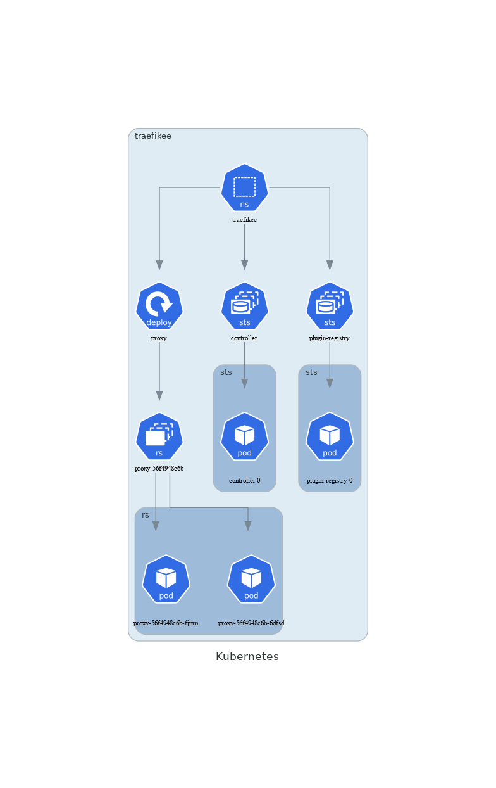

# Kubernetes diagrams
k8s-diagrams creates diagrams from your kubernetes clusters.<br/><br/>
You just have to provide a namespace (or not), and you get a picture from the current state of your cluster.

Two kinds of diagrams can be drawn, both showing the workloads (deployments, replicaSets, daemonSets, statefulSets) and their pods:
- a **network** diagram (the default), showing how the traffic reaches the pods: services and their endpointSlices
  (including ExternalName, NodePort, external IPs and load balancers), ingresses and ingressClasses,
  and the [Gateway API](https://gateway-api.sigs.k8s.io/) gatewayClasses, gateways, and HTTP/GRPC/TLS/TCP/UDP routes
  (when its CRDs are installed);
- a **storage** diagram (`--storage`), showing the volumes used by the pods: persistentVolumeClaims, persistentVolumes
  and storageClasses, ephemeral and node-local volumes (emptyDir, generic ephemeral, CSI, image, hostPath, NFS),
  and the mounted configMaps and secrets.

## How do I build it?
```sh
$ just build
```

## Usage
```sh
$ ./k8s-diagrams --help
NAME:
   k8s-diagrams - Create diagram from the Kubernetes API: a network diagram by default, or a storage one.

USAGE:
   k8s-diagrams [global options]

GLOBAL OPTIONS:
   --namespace string, -n string        The namespace we want to draw (defaults to the namespace of the kubeconfig context). [$KUBECTL_NAMESPACE]
   --kubeconfig string, -c string       The path to your kube config file (defaults to $KUBECONFIG, then ~/.kube/config).
   --context string                     The kubeconfig context to use (defaults to the current context).
   --outputFilename string, -o string   The output filename. (default: "k8s")
   --outputDirectory string, -d string  The output directory. (default: "diagrams")
   --label string, -l string            The diagram label. (default: "Kubernetes")
   --storage                            Draw the volumes used by the workloads, instead of how the traffic reaches them.
   --log-level string                   The log level (debug, info, warn, error). (default: "info") [$LOG_LEVEL]
   --help, -h                           show help
   --version, -v                        print the version
```

## Usage example
```sh
$ ./k8s-diagrams -n mynamespace -d diagrams -o k8s
$ cd diagrams
$ dot -Tpng k8s.dot > k8s.png
```

Or, with [just](https://github.com/casey/just) and the namespace in `$NAMESPACE`:
```sh
$ just render            # network diagram, as diagram.png
$ just render --storage  # storage diagram, as diagram.png
```

## Render example

### Small namespace



### Big namespace


